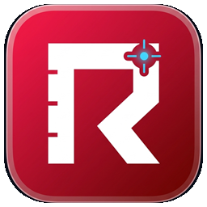
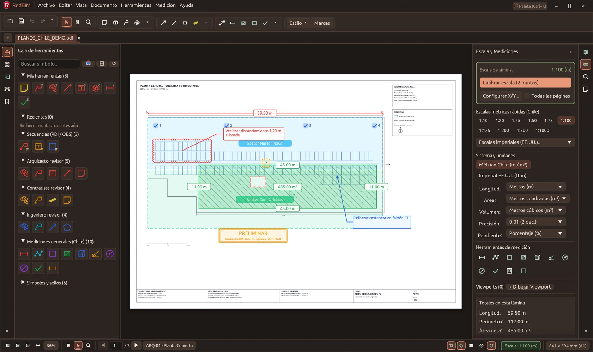
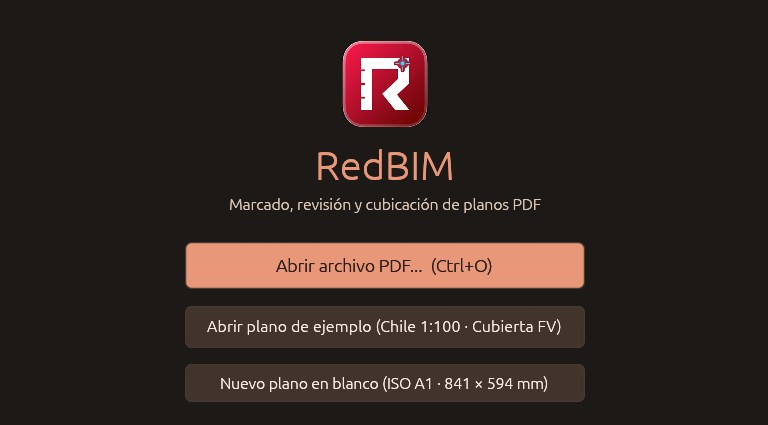

  

# RedBIM

**Revisa, anota y cubica planos PDF en Windows.** RedBIM es una aplicación de escritorio en español para arquitectura, ingeniería y construcción. Trabaja con formatos ISO y unidades métricas de forma predeterminada y admite unidades imperiales.

[Descargar para Windows x64][descarga] · [Ver versiones][versiones] · [Guía de funciones](docs/funciones.md)

## Instalar y actualizar

1. Descarga [`RedBIM-Setup-x64.exe`][descarga] y ábrelo. El instalador crea un acceso en Inicio para tu usuario y ofrece un acceso en el escritorio.
2. Abre **RedBIM** desde Inicio. En **Archivo → Abrir plano de ejemplo**, puedes practicar con tres láminas y marcas incluidas.
3. Al abrir RedBIM, la app busca versiones nuevas en GitHub. Si hay una, elige **Descargar actualización**, guarda tus planos y selecciona **Abrir instalador**. La actualización conserva los planos y las preferencias.

Compatible con **Windows 10 22H2 y Windows 11 en x64**. La desinstalación está disponible en **Configuración → Aplicaciones**. El instalador inicial carece de firma Authenticode y Windows puede mostrar una advertencia de SmartScreen. En cada versión encontrarás `SHA256SUMS.txt` para verificar la descarga. [Información de Microsoft sobre SmartScreen](https://learn.microsoft.com/windows/apps/package-and-deploy/smartscreen-reputation)

## Qué puedes hacer

- **Revisar planos.** Abre varios PDF en pestañas, navega por miniaturas y compara revisiones mediante una superposición de diferencias.
- **Anotar sobre la lámina.** Agrega notas, flechas, nubes y sellos. Encuentra, filtra y exporta las marcas desde su lista.
- **Cubicar y presupuestar.** Calibra la escala con dos puntos, mide longitudes, áreas o volúmenes y registra conteos y precios unitarios. Exporta a CSV para Excel.
- **Preparar entregas.** Combina, extrae y reorganiza páginas. Exporta PDF aplanados para fijar las marcas en la lámina.

RedBIM trabaja con tus archivos localmente. Puedes volver a consultar GitHub desde **Ayuda → Buscar actualizaciones**. El [`PDF de ejemplo`](samples/plano_demo_chile.pdf) también está en el repositorio.

## Desarrollo

- [Compilar, empaquetar y publicar](docs/publicar.md)
- [Historial de cambios](CHANGELOG.md)
- [Reportar un problema][problemas]

Código bajo [licencia MIT](LICENSE). Los avisos de dependencias se incluyen en el instalador.

[descarga]: https://github.com/matfigueroac/redbim/releases/latest/download/RedBIM-Setup-x64.exe
[versiones]: https://github.com/matfigueroac/redbim/releases
[problemas]: https://github.com/matfigueroac/redbim/issues
